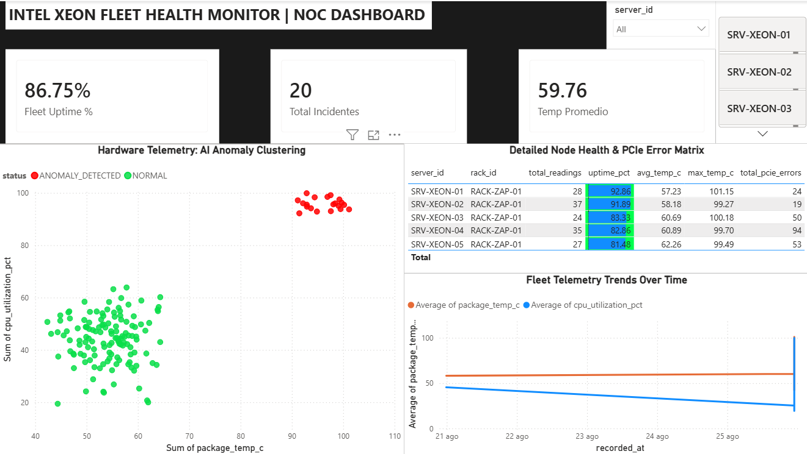
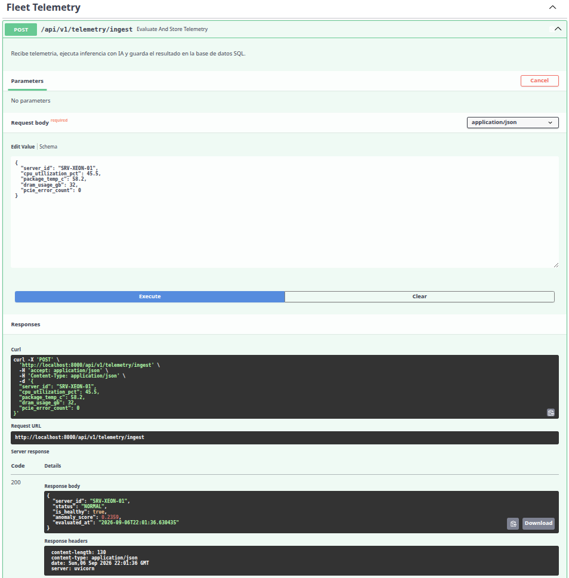
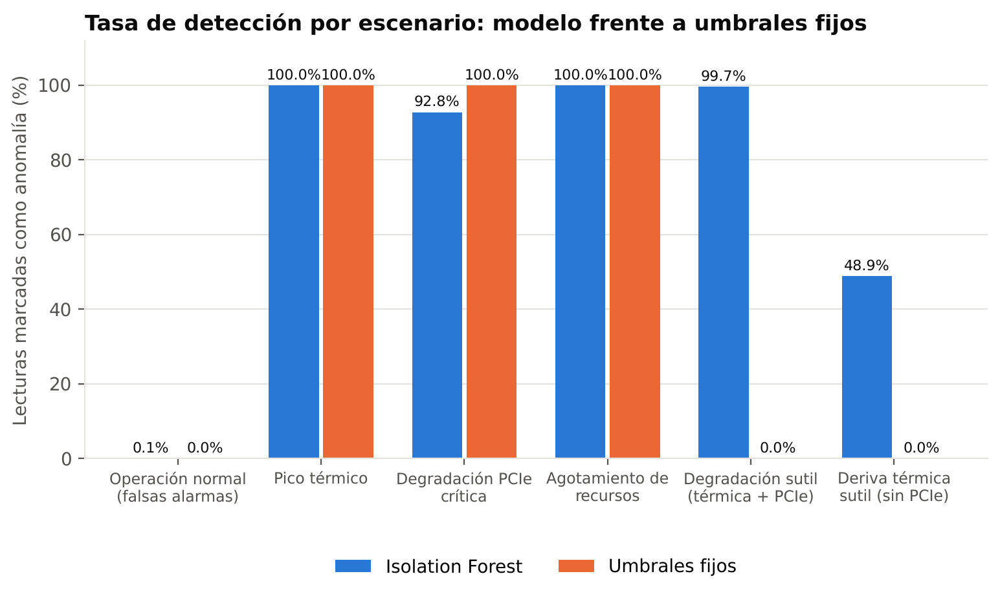

# Server Health Detector: Fleet Telemetry & Unsupervised Anomaly Detection

[](https://www.python.org/)
[](https://fastapi.tiangolo.com/)
[](https://scikit-learn.org/)
[](https://powerbi.microsoft.com/)

An end-to-end data engineering, telemetry ingestion, and machine learning monitoring platform. The system ingests streaming hardware telemetry (CPU utilization, package temperature, DRAM usage, and PCIe error counters), detects multivariate operational degradation using an unsupervised Isolation Forest model, persists structured logs into a local datalake/SQLite store, and surfaces operational health via an enterprise-grade Power BI Network Operations Center (NOC) dashboard versioned through `.pbip`.

---

## 📸 System Previews

| Network Operations Center (NOC) Dashboard | Real-Time API Inference (FastAPI Swagger UI) |
| :---: | :---: |
|  |  |

---

## 🏛 System Architecture & Workflow

The architecture handles the lifecycle from low-level hardware simulation to executive visual diagnostics:

```text
[Synthetic Telemetry Agent]
         │ (CPU %, Package Temp, DRAM, PCIe Errors, Server Metadata)
         ▼
[FastAPI Ingestion Endpoint] ──> [Scikit-Learn Isolation Forest]
         │                                   │ (Anomaly Score / Status)
         ▼                                   ▼
[Relational Database (SQLite)] ──> [Partitioned JSON Datalake Layer]
         │
         ▼
[Analytical SQL Views / CSV Export]
         │
         ▼
[Power BI NOC Dashboard (.pbip)]
```

1. **Hardware Telemetry Simulation (`src/utils/`):** Generates realistic multivariate time-series data reflecting server behavior under standard compute loads as well as severe hardware failure scenarios (thermal throttling, fan failure, bus error saturation).
2. **Unsupervised ML Engine (`src/ai/`):** Utilizes an Isolation Forest algorithm to detect anomalous hardware states without requiring manual static thresholds or pre-labeled operational incidents.
3. **RESTful Service Layer (`src/api/`):** Asynchronous API built with FastAPI providing payload schema validation via Pydantic, low-latency model inference, and persistence handling.
4. **Storage & Datalake (`data/` & `src/database/`):** Implements a two-tier storage layer:
   * **Transactional:** SQLite instance storing validated telemetry, scoring results, and server hardware metadata.
   * **Analytical:** Partitioned JSON datalake (`year=YYYY/month=MM/day=DD`) and processed CSV views (`fleet_master_telemetry.csv`, `fleet_server_kpis.csv`).
5. **Modern Power BI Integration (`server-health-detector/`):** Fully versioned dashboard using Microsoft Power BI Project (`.pbip`) format, separating semantic modeling (`.SemanticModel`) from visual definitions (`.Report`) for transparent Git source control.

---

## 🛠 Tech Stack

* **Programming Language:** Python 3.11
* **Machine Learning & Data Science:** Scikit-Learn (Isolation Forest), NumPy, Pandas
* **API Development:** FastAPI, Uvicorn, Pydantic
* **Persistence & Modeling:** SQLite, SQLAlchemy, Partitioned JSON Datalake
* **Business Intelligence:** Microsoft Power BI Desktop (PBIP Git-integrated format)
* **Quality & Delivery:** Pytest, Docker, GitHub Actions

---

## 📖 Guía en español

* [`docs/GUIA.md`](docs/GUIA.md): explicación del proyecto, instalación paso a paso, escenarios de demostración y de implementación.
* [`docs/GUION_EXPO.md`](docs/GUION_EXPO.md): guion de exposición y preguntas frecuentes.

---

## 🚀 Quickstart

Requires Python 3.11 (the pinned scientific stack does not install on 3.12+).

```bash
python3.11 -m venv .venv && source .venv/bin/activate
pip install -r requirements-dev.txt
uvicorn src.api.main:app --reload
```

The Isolation Forest artifact is not versioned: the API trains and saves it on first start if it is missing. Interactive docs: http://127.0.0.1:8000/docs

In a second terminal, stream a simulated fleet into the API and export the Power BI datasets:

```bash
python -m src.utils.fleet_simulator -n 600 --subtle-rate 0.10 --spread-hours 48 --delay 0
python -m src.database.analytics_views
```

### Docker

```bash
mkdir -p data
docker compose up --build
```

The database, model and exports are written to `./data` on the host. To generate the Power BI CSVs from the container: `docker compose exec api python -m src.database.analytics_views`.

### Power BI dashboard

Open `server-health-detector/fleet_health_dashboard.pbip` in Power BI Desktop. The two tables import `fleet_master_telemetry.csv` and `fleet_server_kpis.csv` from an absolute path, so on a new machine point them to your `data/processed/` folder (*Transform data → Data source settings → Change source*) and refresh.

---

## 🔌 API

| Method | Route | Purpose |
| :--- | :--- | :--- |
| `GET` | `/health` | Checks that the model is loaded and the database responds (503 otherwise) |
| `POST` | `/api/v1/telemetry/ingest` | Validates a reading, scores it and stores it |
| `GET` | `/api/v1/servers/{server_id}/history` | Latest readings of one server (`limit` 1–500) |
| `GET` | `/api/v1/fleet/summary` | Per-server KPIs (same SQL that feeds Power BI) |
| `POST` | `/api/v1/cloud/export-datalake` | Exports not-yet-exported records to the partitioned data lake |

Every response carries an `X-Process-Time-Ms` header with the server-side processing time. Settings (database URL, model path, output folders) can be overridden with `SHD_*` environment variables, see `src/config.py`.

---

## 📊 Evaluation

All telemetry is synthetic. The model is trained on 5,000 unlabeled readings and evaluated on data it has not seen, against a baseline of fixed thresholds (CPU > 90 %, temperature > 85 °C, DRAM > 110 GB, PCIe errors > 5).

```bash
python -m src.evaluation.model_benchmark
python -m src.evaluation.latency_benchmark   # needs the API running
python -m src.evaluation.make_figures
```



| Scenario | Isolation Forest | Fixed thresholds |
| :--- | ---: | ---: |
| Normal operation (false alarms) | 0.1 % | 0.0 % |
| Thermal spike | 100.0 % | 100.0 % |
| Critical PCIe degradation | 92.8 % | 100.0 % |
| Resource exhaustion | 100.0 % | 100.0 % |
| Subtle degradation (low CPU, 68–80 °C, 1–4 PCIe errors) | 99.7 % | 0.0 % |
| Subtle thermal drift (same, no PCIe errors) | 48.9 % | 0.0 % |

On a mixed fleet with 5 % critical failures (20,000 readings) the model reaches F1 0.976 and the thresholds F1 1.000: when a metric is already extreme, a fixed rule is enough. The model earns its place on degradations where every metric stays under its threshold, which fixed rules cannot see at all. The two detectors are complementary.

Ingestion latency over 1,000 requests on a 4-core Linux container (loopback): mean 9.7 ms, p95 11.7 ms, p99 13.3 ms. Raw numbers are in `docs/results/`.

---

## ✅ Tests

```bash
pytest
```

The suite covers the API contract, persistence, export de-duplication, the telemetry scenarios and the model-versus-thresholds criterion. GitHub Actions runs it on every push.

---

## 📁 Repository Structure

```text
├── Dockerfile / docker-compose.yml   # Reproducible deployment
├── requirements.txt                  # Runtime dependencies (pinned)
├── requirements-dev.txt              # + pytest, httpx, matplotlib
├── docs/
│   ├── assets/                       # Screenshots and evaluation figures
│   └── results/                      # Benchmark outputs (JSON)
├── server-health-detector/           # Power BI Project (PBIP): report + TMDL semantic model
├── src/
│   ├── config.py                     # Settings, model hyperparameters, baseline thresholds
│   ├── ai/train_model.py             # Isolation Forest training, loading and serialization
│   ├── api/                          # FastAPI app and Pydantic contracts
│   ├── database/                     # SQLAlchemy models, connection, analytical SQL views
│   ├── evaluation/                   # Model and latency benchmarks, figure generation
│   ├── services/cloud_exporter.py    # Incremental export to the partitioned data lake
│   └── utils/                        # Telemetry scenarios and fleet simulator
└── tests/                            # Pytest suite
```

Generated at runtime and git-ignored: `telemetry.db`, `src/ai/intel_health_model.pkl`, `data/`.
