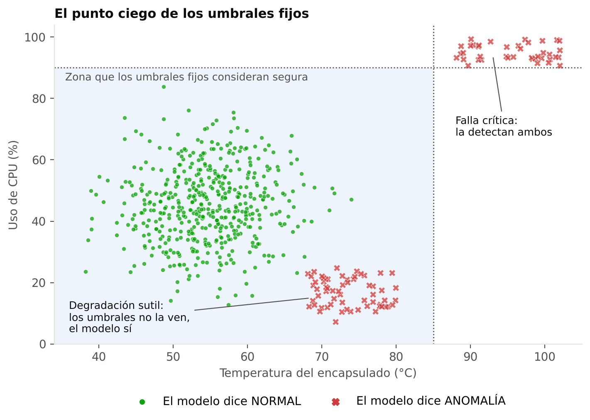
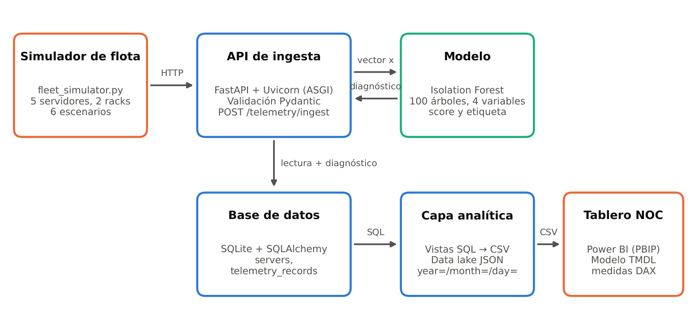
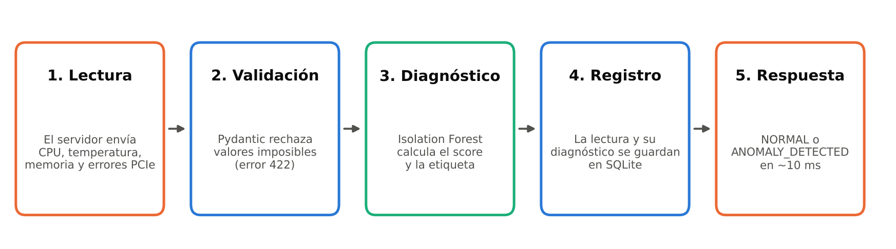
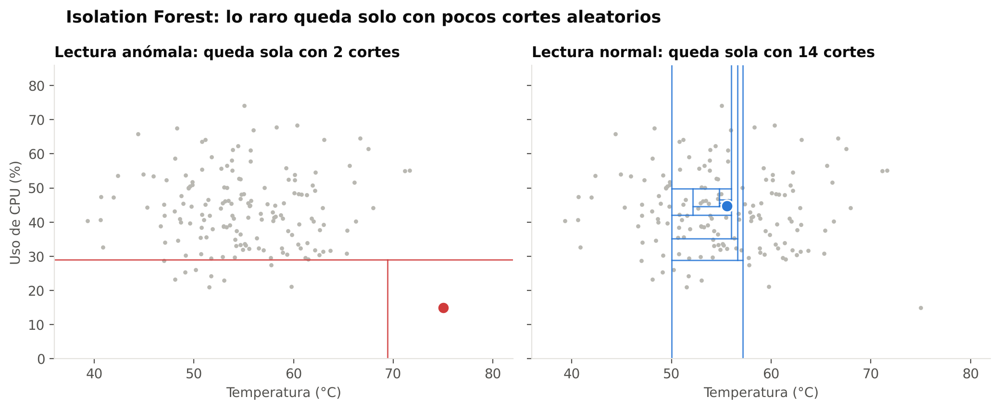
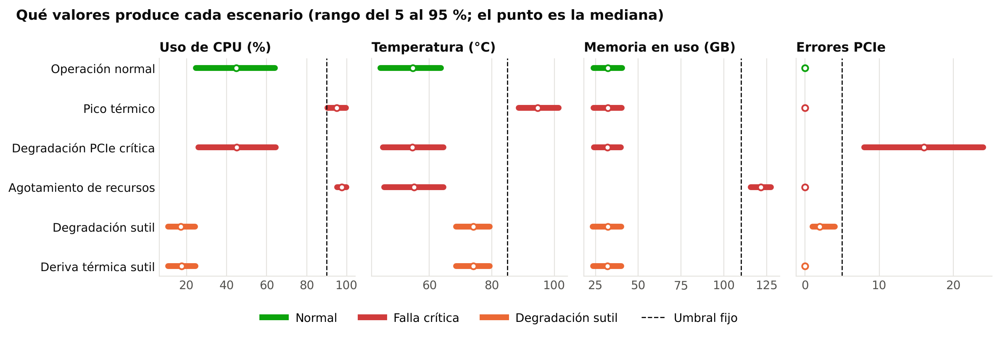

# Guía del proyecto: Server Health Detector

Esta guía explica qué hace el proyecto, cómo funciona por dentro, cómo ejecutarlo en una computadora y en qué situaciones se puede implementar. Está pensada para que cualquier integrante del equipo pueda explicarlo y demostrarlo.

- [1. El proyecto en un minuto](#1-el-proyecto-en-un-minuto)
- [2. El problema: el punto ciego de los umbrales](#2-el-problema-el-punto-ciego-de-los-umbrales)
- [3. Cómo funciona](#3-cómo-funciona)
- [4. Cómo ejecutarlo en tu computadora](#4-cómo-ejecutarlo-en-tu-computadora)
- [5. Escenarios de demostración](#5-escenarios-de-demostración)
- [6. Escenarios de implementación](#6-escenarios-de-implementación)
- [7. Qué se demostró y qué no](#7-qué-se-demostró-y-qué-no)

El guion para exponerlo está en [GUION_EXPO.md](GUION_EXPO.md).

---

## 1. El proyecto en un minuto

Los servidores avisan antes de fallar, pero los sistemas de monitoreo tradicionales no escuchan esos avisos: solo alertan cuando una métrica rebasa un límite fijo (por ejemplo, CPU arriba de 90 %).

**Server Health Detector** recibe las mediciones de cada servidor (uso de CPU, temperatura, memoria y errores del bus PCIe), las analiza **en conjunto** con un modelo de aprendizaje automático y responde en unos 10 milisegundos si la lectura es normal o anómala. Todo queda guardado en una base de datos y se visualiza en un tablero de Power BI.

La idea central: una lectura puede tener todas sus métricas "en verde" y aun así ser anómala por la **combinación** de valores.

---

## 2. El problema: el punto ciego de los umbrales



La zona azul es todo lo que una regla de umbrales considera seguro (CPU menor a 90 % y temperatura menor a 85 °C).

- El grupo de arriba a la derecha son **fallas críticas**: cualquier sistema las detecta, pero para entonces el servidor ya está en problemas.
- El grupo de abajo a la derecha es una **degradación sutil**: el procesador casi no trabaja (CPU de 10 a 25 %) y aun así está caliente (68 a 80 °C). Eso no debería pasar; sugiere un ventilador fallando o pasta térmica degradada. Está dentro de la zona "segura", así que los umbrales no la ven. El modelo sí.

---

## 3. Cómo funciona

### 3.1 Arquitectura



| Componente | Archivo principal | Qué hace |
| :--- | :--- | :--- |
| Simulador de flota | `src/utils/fleet_simulator.py` | Hace el papel de los servidores: envía lecturas a la API |
| API de ingesta | `src/api/main.py` | Recibe, valida, pide el diagnóstico y guarda |
| Modelo | `src/ai/train_model.py` | Isolation Forest entrenado con 5,000 lecturas sin etiquetas |
| Base de datos | `src/database/models.py` | SQLite con las tablas `servers` y `telemetry_records` |
| Capa analítica | `src/database/analytics_views.py` | Consultas SQL que producen los CSV para Power BI |
| Tablero | `server-health-detector/` | Proyecto de Power BI (formato PBIP) |

### 3.2 El recorrido de una lectura



Una lectura es un JSON como este:

```json
{
  "server_id": "SRV-XEON-01",
  "cpu_utilization_pct": 15.0,
  "package_temp_c": 70.0,
  "dram_usage_gb": 32.0,
  "pcie_error_count": 2
}
```

Y la respuesta de la API:

```json
{
  "server_id": "SRV-XEON-01",
  "status": "ANOMALY_DETECTED",
  "is_healthy": false,
  "anomaly_score": -0.0631,
  "evaluated_at": "2026-11-12T22:00:37.738197"
}
```

El `anomaly_score` es la puntuación del modelo: **negativa significa anomalía**, positiva significa normal, y mientras más lejos de cero, más seguro está el modelo.

### 3.3 Cómo decide el modelo (Isolation Forest)



El algoritmo no aprende qué es una falla; aprende qué tan fácil es **aislar** una lectura del resto.

1. Toma las lecturas y traza un corte al azar (una variable al azar, un valor al azar).
2. Se queda con el lado donde está la lectura que le interesa y repite.
3. Cuenta cuántos cortes necesitó para dejarla sola.

Una lectura rara vive lejos de las demás, así que queda sola con muy pocos cortes (panel izquierdo). Una lectura normal está rodeada de vecinas y necesita muchos (panel derecho). El modelo repite este juego en 100 árboles distintos y promedia: **pocos cortes en promedio = anomalía**.

La ventaja es que no necesita ejemplos de fallas etiquetadas, que en la práctica casi nunca existen.

### 3.4 Los seis escenarios simulados



La línea punteada es el umbral fijo de cada métrica. Las fallas críticas (rojo) cruzan al menos un umbral. Las degradaciones sutiles (naranja) no cruzan ninguno: por eso son el caso interesante.

---

## 4. Cómo ejecutarlo en tu computadora

### 4.1 Obtener la rama

Si todavía no tienes el repositorio:

```bash
git clone -b feat/reproducible-demo-and-evaluation https://github.com/ErnestoEsqG/server-health-detector.git
```

```bash
cd server-health-detector
```

Si ya lo tienes clonado:

```bash
git fetch origin
```

```bash
git checkout feat/reproducible-demo-and-evaluation
```

### 4.2 Opción A: con Python 3.11

Se necesita exactamente Python 3.11 (las versiones fijadas de NumPy y SciPy no instalan en 3.12 o superior). Comprueba tu versión con `python --version`.

**Windows (PowerShell):**

```powershell
py -3.11 -m venv .venv
```

```powershell
.venv\Scripts\Activate.ps1
```

```powershell
pip install -r requirements-dev.txt
```

**Linux o macOS:**

```bash
python3.11 -m venv .venv && source .venv/bin/activate
```

```bash
pip install -r requirements-dev.txt
```

Después, en cualquier sistema:

```bash
pytest
```

Deben pasar 21 pruebas. Luego inicia la API:

```bash
uvicorn src.api.main:app
```

La primera vez tarda unos segundos porque entrena el modelo. Abre http://127.0.0.1:8000/docs para ver la documentación interactiva.

### 4.3 Opción B: con Docker

No requiere instalar Python.

```bash
mkdir data
```

```bash
docker compose up --build
```

La API queda en http://127.0.0.1:8000/docs y los datos en la carpeta `data/`.

### 4.4 Enviar telemetría y ver resultados

Con la API corriendo, abre **otra terminal** (con el entorno virtual activado) y ejecuta:

```bash
python -m src.utils.fleet_simulator -n 600 --subtle-rate 0.10 --spread-hours 48 --delay 0
```

Al final imprime un resumen por escenario. Para consultar lo guardado:

- Resumen de la flota: http://127.0.0.1:8000/api/v1/fleet/summary
- Historial de un servidor: http://127.0.0.1:8000/api/v1/servers/SRV-XEON-01/history

### 4.5 Actualizar el tablero de Power BI

```bash
python -m src.database.analytics_views
```

Esto crea `data/processed/fleet_master_telemetry.csv` y `fleet_server_kpis.csv`. En Power BI Desktop abre `server-health-detector/fleet_health_dashboard.pbip`, ve a *Transformar datos → Configuración de origen de datos → Cambiar origen*, apunta cada tabla a su CSV en tu carpeta `data/processed/` y pulsa *Actualizar*.

### 4.6 Repetir las mediciones del protocolo

```bash
python -m src.evaluation.model_benchmark
```

```bash
python -m src.evaluation.latency_benchmark --requests 1000
```

```bash
python -m src.evaluation.make_figures
```

Los resultados quedan en `docs/results/` y las figuras en `docs/assets/`.

### 4.7 Problemas frecuentes

| Síntoma | Causa y solución |
| :--- | :--- |
| `pip install` falla al compilar NumPy o SciPy | No estás usando Python 3.11; crea el entorno con `py -3.11` o `python3.11` |
| PowerShell no deja activar el entorno | Ejecuta `Set-ExecutionPolicy -Scope CurrentUser RemoteSigned` y vuelve a intentar |
| El simulador dice "Sin conexión con la API" | La API no está corriendo; inicia `uvicorn` en otra terminal |
| "Address already in use" al iniciar la API | El puerto 8000 está ocupado; usa `uvicorn src.api.main:app --port 8001` y `--url http://127.0.0.1:8001` en el simulador |
| Quiero empezar de cero | Detén la API y borra `telemetry.db` (y `data/` si usas Docker) |

---

## 5. Escenarios de demostración

Cada escenario se puede lanzar por separado con `--scenario`, o pegando el JSON en `/docs` (endpoint *POST /api/v1/telemetry/ingest* → *Try it out*).

| # | Escenario | Qué representa | Comando | Qué esperar |
| :-- | :--- | :--- | :--- | :--- |
| 1 | `normal` | Servidor sano | `python -m src.utils.fleet_simulator -n 20 --scenario normal` | Todo NORMAL |
| 2 | `thermal_spike` | Falla de enfriamiento bajo carga | `... -n 20 --scenario thermal_spike` | Todo ANOMALIA |
| 3 | `pcie_degradation` | Tarjeta o enlace PCIe fallando | `... -n 20 --scenario pcie_degradation` | Casi todo ANOMALIA (≈93 %) |
| 4 | `resource_exhaustion` | Proceso que agota CPU y memoria | `... -n 20 --scenario resource_exhaustion` | Todo ANOMALIA |
| 5 | `subtle_degradation` | Caliente sin trabajar y con errores esporádicos | `... -n 20 --scenario subtle_degradation` | Todo ANOMALIA, aunque ningún umbral se cruza |
| 6 | `subtle_thermal_drift` | Igual, pero sin errores PCIe | `... -n 20 --scenario subtle_thermal_drift` | Cerca de la mitad ANOMALIA |

Lecturas listas para pegar en `/docs`:

**Servidor sano** (responde NORMAL):

```json
{"server_id": "SRV-DEMO", "cpu_utilization_pct": 45, "package_temp_c": 55, "dram_usage_gb": 32, "pcie_error_count": 0}
```

**Falla crítica** (responde ANOMALY_DETECTED; un umbral también la detectaría):

```json
{"server_id": "SRV-DEMO", "cpu_utilization_pct": 99, "package_temp_c": 96.5, "dram_usage_gb": 122, "pcie_error_count": 18}
```

**Degradación sutil** (responde ANOMALY_DETECTED; ningún umbral se cruza):

```json
{"server_id": "SRV-DEMO", "cpu_utilization_pct": 15, "package_temp_c": 70, "dram_usage_gb": 32, "pcie_error_count": 2}
```

**Lectura imposible** (la API la rechaza con error 422):

```json
{"server_id": "SRV-DEMO", "cpu_utilization_pct": 150, "package_temp_c": 55, "dram_usage_gb": 32, "pcie_error_count": 0}
```

El escenario 6 conviene mostrarlo con honestidad: el modelo detecta solo la mitad cuando no hay errores PCIe. Es una limitación medida, no un defecto oculto.

---

## 6. Escenarios de implementación

Cuatro formas de llevar el proyecto más allá de la demostración, de menor a mayor esfuerzo. Solo la primera está implementada; las demás describen qué habría que construir.

### 6.1 Demostración en una laptop (implementado)

- **Para qué:** clase, Expo Proyectos, entrevistas.
- **Cómo:** todo corre en un equipo; el simulador hace de flota.
- **Requiere:** Python 3.11 o Docker.

### 6.2 Laboratorio de cómputo con equipos reales

- **Para qué:** monitorear las computadoras de un laboratorio del centro universitario o un servidor del equipo.
- **Cómo:** la API corre en un equipo de la red local; cada computadora monitoreada ejecuta un pequeño agente que lee sus sensores cada cierto tiempo y envía la lectura por HTTP.
- **Falta construir:** el agente. En Linux puede leer CPU y memoria con la biblioteca `psutil`, la temperatura con `psutil.sensors_temperatures()` y los errores PCIe del sistema de archivos `/sys/bus/pci/devices/*/aer_dev_correctable`. En Windows la temperatura requiere herramientas adicionales.
- **Punto crítico:** el modelo debe **reentrenarse con lecturas reales** de esos equipos. El actual aprendió de datos sintéticos con 128 GB de memoria como referencia y no sirve tal cual para otro hardware.

### 6.3 Pequeña empresa con servidores propios

- **Para qué:** una organización con pocos servidores físicos y sin presupuesto para herramientas comerciales.
- **Cómo:** el contenedor de Docker en un servidor interno, agentes en cada equipo y el tablero de Power BI para el responsable de sistemas.
- **Falta construir:** autenticación en la API (hoy cualquiera en la red puede enviar lecturas), cambiar SQLite por PostgreSQL para escrituras concurrentes, y una notificación (correo o mensajería) cuando aparece una anomalía.
- **Recomendación:** usar el modelo **junto con** los umbrales fijos, no en lugar de ellos. Los umbrales cubren mejor las fallas críticas de una sola métrica; el modelo cubre las degradaciones sutiles.

### 6.4 Flota en la nube

- **Para qué:** cientos de servidores en uno o varios centros de datos.
- **Cómo:** la API como servicio con varias réplicas, una cola de mensajes para absorber picos de ingesta, una base de datos administrada y el data lake en almacenamiento de objetos. El exportador ya escribe con particiones `year=/month=/day=`, que es el formato que esos servicios esperan.
- **Falta construir:** la escritura a almacenamiento de objetos, conexión directa de Power BI a la base (en lugar de CSV), reentrenamiento periódico del modelo y un modelo por tipo de servidor.

---

## 7. Qué se demostró y qué no

**Demostrado con mediciones** (ver `docs/results/`):

| Indicador | Resultado |
| :--- | :--- |
| Detección de degradación sutil | Modelo 99.7 %, umbrales fijos 0 % |
| Falsas alarmas en operación normal | 0.1 % |
| Latencia de ingesta (percentil 95) | 11.7 ms, frente a un objetivo de 100 ms |
| Flota mixta con fallas críticas | Modelo F1 0.976, umbrales F1 1.000 |

**Limitaciones que hay que decir en voz alta:**

- Toda la telemetría es **simulada**. No se ha probado con servidores físicos.
- En fallas críticas los umbrales fijos son iguales o mejores que el modelo. El modelo es un complemento.
- Sin errores PCIe, la detección de deriva térmica baja a 48.9 %.
- El modelo ve cada lectura por separado; no analiza tendencias en el tiempo.
- El tablero se actualiza por lotes (CSV), no en tiempo real.
